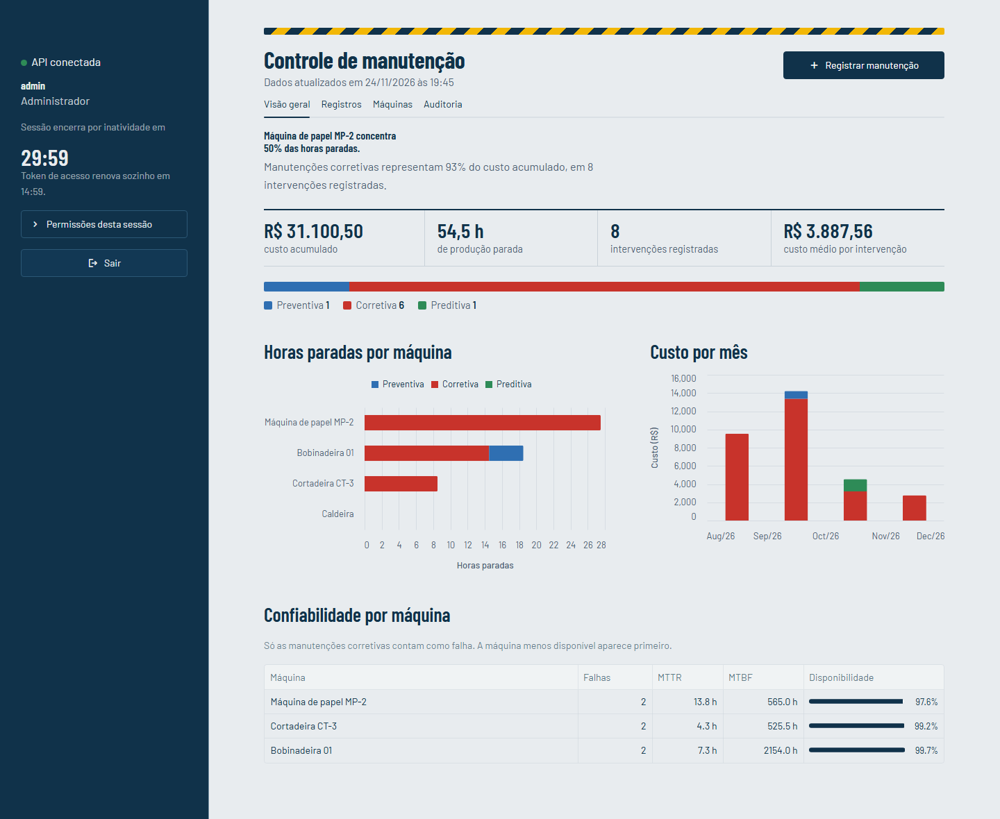
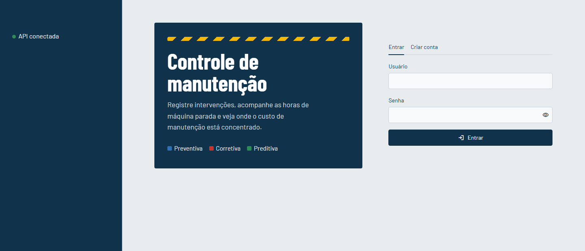
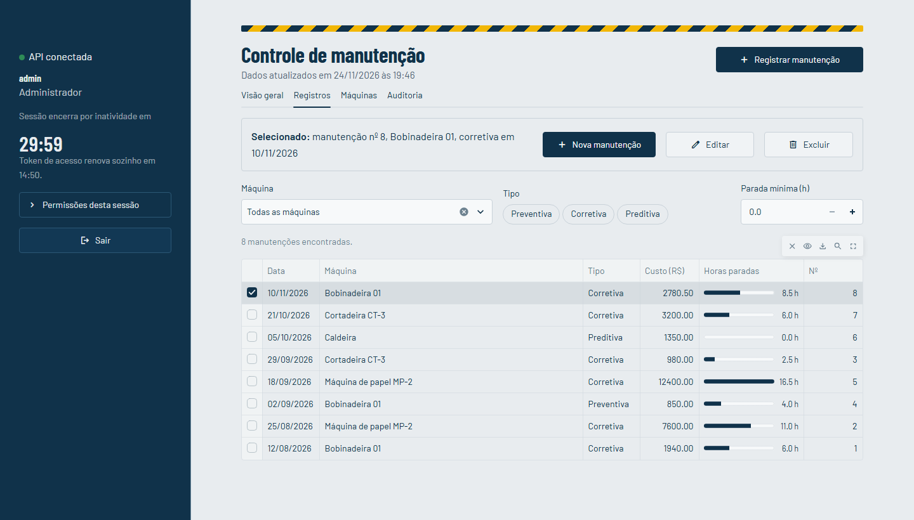
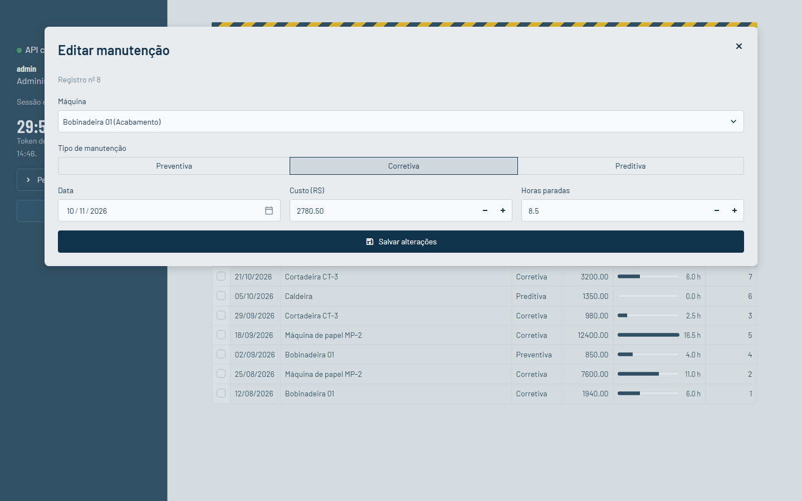
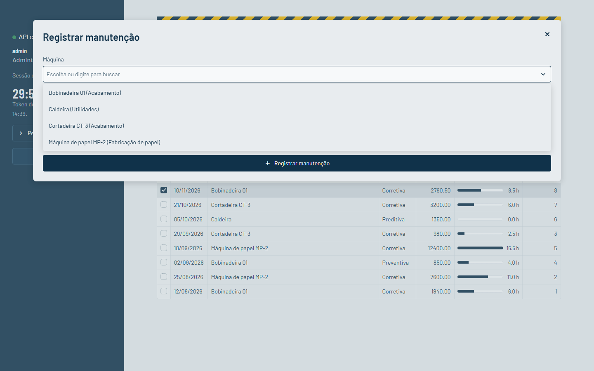
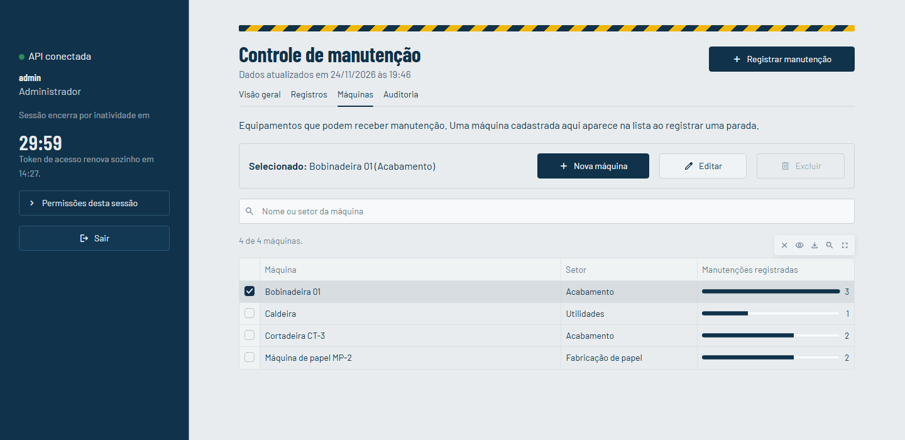
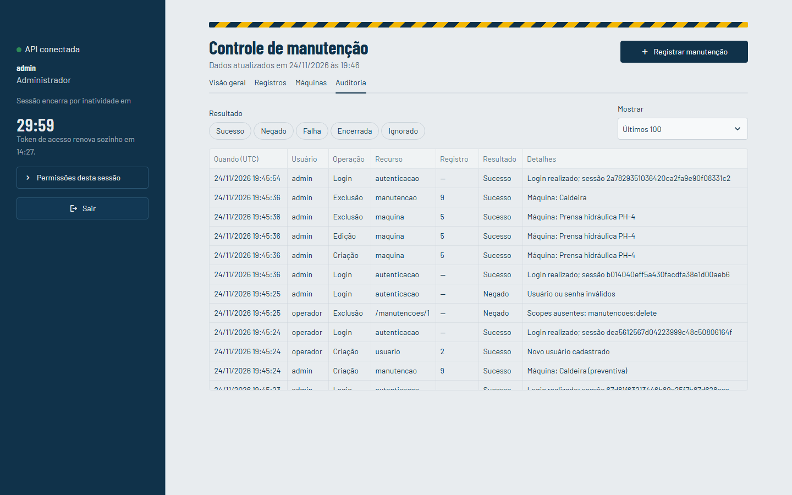
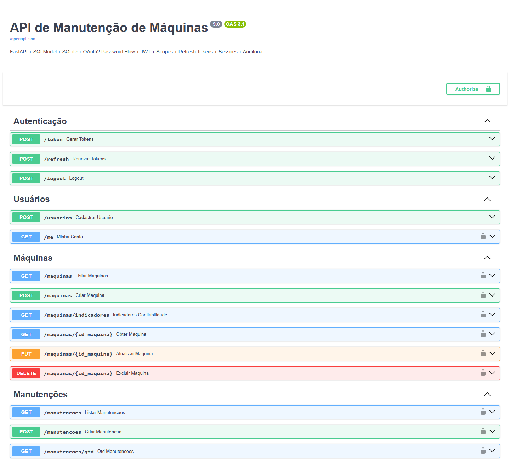
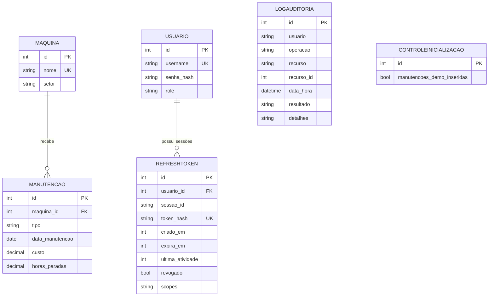
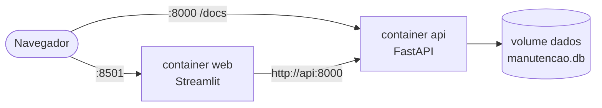

# 🛠️ Sistema de Manutenção de Máquinas

Estudo de caso de **aplicação distribuída em Python** — reprodução do roteiro
*"Estudo de Caso – Sistema Distribuído"* até a **versão 9**, com o modelo
conceitual de vendas substituído por um cenário de **manutenção de máquinas
industriais**.

| | |
|---|---|
| **Backend** | API REST com [FastAPI](https://fastapi.tiangolo.com/) + [SQLModel](https://sqlmodel.tiangolo.com/) + SQLite |
| **Frontend** | Interface web com [Streamlit](https://streamlit.io/) |
| **Segurança** | OAuth2 Password Flow, JWT, scopes, refresh token com rotação, sessões com timeout e auditoria |



## 👥 Integrantes

- **Cristiano Pirolli**
- **Ryan Lirio**

---

## Sumário

1. [Telas](#%EF%B8%8F-telas)
2. [Estratégia adotada](#-estratégia-adotada)
3. [Modelo de dados (MER)](#-modelo-de-dados-mer)
4. [Estrutura do projeto](#-estrutura-do-projeto)
5. [Instalação](#-instalação)
6. [Execução](#-execução)
7. [Execução com Docker](#-execução-com-docker)
8. [Usando o sistema](#-usando-o-sistema)
9. [Configuração](#%EF%B8%8F-configuração)
10. [Solução de problemas](#-solução-de-problemas)
11. [Documentação complementar](#-documentação-complementar)

---

## 🖼️ Telas

Capturas feitas com os dados de exemplo da primeira execução.

### Acesso

Login e criação de conta. As cores dos três tipos de manutenção já aparecem
aqui e se repetem em todo o sistema.



### Visão geral

Frase de destaque gerada dos dados, indicadores de custo e horas paradas,
proporção por tipo, gráficos e a tabela de confiabilidade (MTTR, MTBF e
disponibilidade), com a máquina menos disponível no topo.


### Registros (CRUD de manutenções)

Barra **Nova / Editar / Excluir** acima da tabela; Editar e Excluir são
habilitados ao selecionar uma linha. Filtros por máquina, tipo e parada mínima.



| Editar manutenção | Registrar manutenção |
|---|---|
|  |  |
| A janela abre preenchida com o registro selecionado. | A máquina é escolhida na lista das máquinas cadastradas. |

### Máquinas (CRUD de máquinas)

Mesma barra de ações, com busca por nome ou setor. Excluir fica desabilitado
para máquinas com manutenções registradas.



### Auditoria (somente admin)

Cada login, criação, edição, exclusão e acesso negado fica registrado, com
filtro por resultado.



### API (Swagger)

Documentação interativa gerada pelo FastAPI em `/docs`.



---

## 🎯 Estratégia adotada

Entre as duas alternativas propostas no trabalho, seguimos a **alternativa 2**:

> Mesma linguagem (Python) e mesmas bibliotecas (FastAPI no backend, Streamlit
> no frontend), **modificando o modelo conceitual / MER**.

O CRUD de `vendas` (`id`, `item`, `preco_unitario`, `quantidade`) foi trocado
por um CRUD de **manutenções de máquinas**. Toda a camada de segurança da
versão 9 foi preservada.

Além da troca de domínio, o código monolítico do roteiro (`backend_fastapi.py`
e `frontend_streamlit.py`) foi **reorganizado em pacotes e apps**, seguindo
boas práticas de projetos Python — veja [docs/ARQUITETURA.md](docs/ARQUITETURA.md).
A versão monolítica original continua disponível no primeiro commit do
histórico do Git.

### Equivalência com o roteiro

| Vendas (roteiro original) | Manutenções (este projeto) |
|---|---|
| `GET /vendas` | `GET /manutencoes` |
| `GET /vendas/qtd-vendas` | `GET /manutencoes/qtd` |
| `GET /vendas/faturamento` (preço × qtd) | `GET /manutencoes/resumo` (custo total + horas paradas) |
| `GET /vendas/busca?nome=&min_qtd=` | `GET /manutencoes/busca?maquina=&maquina_id=&tipo=&min_horas=` |
| `GET / PUT / DELETE /vendas/{id}`, `POST /vendas` | `GET / PUT / DELETE /manutencoes/{id}`, `POST /manutencoes` |
| — (o item da venda era texto livre) | `GET / POST / PUT / DELETE /maquinas` (cadastro de máquinas) |
| scopes `vendas:read/create/update/delete` | scopes `manutencoes:*` e `maquinas:*` (read/create/update/delete) |
| banco `vendas.db` | banco `manutencao.db` |
| `uvicorn backend_fastapi:app` | `uvicorn backend.main:app` |
| `streamlit run frontend_streamlit.py` | `streamlit run frontend/app.py` |

---

## 🗄️ Modelo de dados (MER)

### Tabelas do domínio

Cada manutenção pertence a uma máquina cadastrada (relação 1:N).

**`maquina`**

| Campo | Tipo | Regra de negócio |
|---|---|---|
| `id` | INTEGER | Chave primária |
| `nome` | VARCHAR(100) | Obrigatório e único (sem diferenciar maiúsculas de minúsculas) |
| `setor` | VARCHAR(60) | Opcional |

**`manutencao`**

| Campo | Tipo | Regra de negócio |
|---|---|---|
| `id` | INTEGER | Chave primária |
| `maquina_id` | INTEGER | Chave estrangeira para `maquina.id`; a máquina precisa existir |
| `tipo` | VARCHAR | `preventiva`, `corretiva` ou `preditiva` |
| `data_manutencao` | DATE | Não pode estar no futuro |
| `custo` | NUMERIC(10,2) | Maior que zero |
| `horas_paradas` | NUMERIC(6,1) | Zero ou mais |

Uma máquina com manutenções registradas não pode ser excluída, apenas
renomeada — assim nenhum registro fica sem máquina.

### Diagrama completo

As tabelas `usuario`, `refreshtoken` e `logauditoria` são as mesmas da versão 9
do roteiro.



---

## 📁 Estrutura do projeto

```
manutencao/
├── backend/                      # API FastAPI
│   ├── main.py                   # Ponto de entrada (app, CORS, routers, lifespan)
│   ├── core/                     # Infraestrutura compartilhada
│   │   ├── config.py             # Configurações via variáveis de ambiente
│   │   ├── database.py           # Engine e sessão por requisição (SessionDep)
│   │   ├── security.py           # Hash de senha, JWT, scopes, refresh tokens
│   │   ├── inicializacao.py      # Criação de tabelas, migrações e carga inicial
│   │   ├── schemas.py            # Schemas genéricos
│   │   └── compat.py             # Ajustes de plataforma (Windows)
│   └── apps/                     # Módulos de domínio
│       ├── autenticacao/         # /token, /refresh, /logout + dependência de auth
│       ├── usuarios/             # /usuarios, /me
│       ├── maquinas/             # CRUD /maquinas + indicadores MTTR/MTBF
│       ├── manutencoes/          # CRUD /manutencoes
│       └── auditoria/            # /auditoria
│           # Cada app: models.py · schemas.py · service.py · router.py
│
├── frontend/                     # Interface Streamlit
│   ├── app.py                    # Ponto de entrada (orquestra as telas)
│   ├── core/                     # Infraestrutura do cliente
│   │   ├── config.py             # URL da API e constantes
│   │   ├── api_client.py         # HTTP com renovação automática de token
│   │   ├── estado.py             # Gerenciamento do st.session_state
│   │   ├── formatadores.py       # Moeda, horas e tempo (funções puras)
│   │   ├── crud.py               # Barra de ações e tabela selecionável (CRUD)
│   │   └── estilo.py             # Identidade visual (CSS complementar ao tema)
│   └── apps/                     # Telas por domínio
│       ├── autenticacao/         # Tela de acesso, perfil e barra lateral
│       ├── maquinas/             # Cadastro de máquinas e lista suspensa
│       ├── manutencoes/          # Visão geral, registros, gráficos e janelas modais
│       └── auditoria/            # Aba de auditoria
│
├── .streamlit/config.toml        # Tema: cores, fontes e barra lateral
├── docs/
│   ├── img/                      # Capturas de tela usadas neste README
│   ├── ARQUITETURA.md            # Decisões de arquitetura e fluxos
│   └── API.md                    # Referência dos endpoints
├── docker-compose.yml            # Sobe API e interface em containers separados
├── .env.example                  # Modelo de variáveis de ambiente
└── requirements.txt              # Dependências do projeto (inclui as duas partes)
```

`backend/` e `frontend/` têm cada um o seu `requirements.txt` e o seu
`Dockerfile`, de modo que cada lado pode ser instalado e publicado sozinho.

---

## 📦 Instalação

**Pré-requisitos:** Python 3.10 ou superior (testado com 3.14) e Git.

### Opção A — PyCharm (conforme capítulo 2 do roteiro)

1. **Clonar o projeto:** `File ▸ Project from Version Control…` e informar a URL
   deste repositório.
2. **Criar o interpretador:** `File ▸ Settings ▸ Project ▸ Python Interpreter ▸
   Add Interpreter ▸ Add Local Interpreter ▸ Virtualenv Environment ▸ New`,
   com a pasta `.venv` dentro do projeto.
3. **Instalar as dependências** no terminal embutido do PyCharm
   (`View ▸ Tool Windows ▸ Terminal`):

   ```bash
   pip install -r requirements.txt
   ```

### Opção B — Linha de comando

```bash
git clone https://github.com/CristianoPirolli/manutencao-maquinas.git
cd manutencao-maquinas

python -m venv .venv
# Windows
.venv\Scripts\activate
# Linux / macOS
source .venv/bin/activate

pip install -r requirements.txt
```

---

## ▶️ Execução

O sistema é **distribuído em dois processos**. Abra **dois terminais** na raiz do
projeto (no PyCharm, use o botão `+` do terminal embutido para abrir uma
segunda sessão), ambos com o ambiente virtual ativo.

**Terminal 1 — backend (API):**

```bash
uvicorn backend.main:app --reload
```

- API: <http://127.0.0.1:8000>
- Documentação interativa (Swagger): <http://127.0.0.1:8000/docs>

**Terminal 2 — frontend (interface):**

```bash
streamlit run frontend/app.py
```

- Interface: <http://localhost:8501> (abre automaticamente no navegador)

Na primeira execução o backend cria o banco `manutencao.db` na raiz do projeto,
com **4 máquinas e 8 manutenções de exemplo** e o **usuário administrador**.

---

## 🐳 Execução com Docker

Alternativa que dispensa Python e ambiente virtual: só é preciso o
[Docker Desktop](https://www.docker.com/products/docker-desktop/) aberto.

```bash
docker compose up --build
```

- Interface: <http://localhost:8501>
- API (Swagger): <http://localhost:8000/docs>

O Compose sobe **dois containers independentes**, cada um com a sua imagem, que
só se comunicam por HTTP. É o mesmo desenho do sistema distribuído, agora
isolado em "máquinas" separadas:



- Dentro da rede do Compose, a interface encontra a API pelo nome do serviço
  (`API_URL=http://api:8000`).
- A interface só sobe depois que a API responde ao *health check*.
- O banco fica no volume `dados`, então os registros continuam lá depois de
  `docker compose down`. Para começar do zero: `docker compose down -v`.
- Os containers rodam com um usuário sem privilégios de administrador.

| Comando | Efeito |
|---|---|
| `docker compose up --build -d` | Sobe em segundo plano |
| `docker compose logs -f api` | Acompanha os logs da API |
| `docker compose down` | Para os containers (mantém os dados) |
| `docker compose down -v` | Para e apaga o banco |

Para trocar a chave dos tokens ou a senha inicial do admin, copie
`.env.example` para `.env` e preencha. Se as portas 8000 ou 8501 já estiverem
em uso (por exemplo, pela execução local), troque-as na hora de subir:

```bash
# Linux / macOS / Git Bash
API_PORT=8010 WEB_PORT=8511 docker compose up --build
# Windows (PowerShell)
$env:API_PORT=8010; $env:WEB_PORT=8511; docker compose up --build
```

---

## 🖥️ Usando o sistema

### Credenciais iniciais

| Perfil | Usuário | Senha |
|---|---|---|
| Administrador | `admin` | `admin123` |

Novos usuários podem ser criados pela própria tela de login (perfil comum).

### Permissões por perfil

| Ação | Scope | Admin | Usuário comum |
|---|---|:---:|:---:|
| Consultar máquinas | `maquinas:read` | ✅ | ✅ |
| Cadastrar, editar e excluir máquinas | `maquinas:create/update/delete` | ✅ | ❌ |
| Consultar manutenções e indicadores | `manutencoes:read` | ✅ | ✅ |
| Registrar manutenção | `manutencoes:create` | ✅ | ✅ |
| Alterar manutenção | `manutencoes:update` | ✅ | ✅ |
| Excluir manutenção | `manutencoes:delete` | ✅ | ❌ |
| Consultar auditoria | `auditoria:read` | ✅ | ❌ |

### Funcionalidades da interface

A identidade visual segue o código de cores de segurança industrial: faixa de
advertência amarela, e cada tipo de manutenção com sua cor —
**preventiva** em azul (ação planejada), **corretiva** em vermelho (falha) e
**preditiva** em verde (condição monitorada).

- **Visão geral:** uma frase gerada a partir dos dados aponta a máquina com mais
  horas paradas e o peso das corretivas no custo; abaixo, os indicadores (custo
  acumulado, horas paradas, intervenções e custo médio), a proporção por tipo e
  os gráficos de horas paradas por máquina e de custo por mês.
- **Confiabilidade por máquina** (na Visão geral): **MTTR** (tempo médio de
  reparo), **MTBF** (tempo médio entre falhas) e **disponibilidade**
  = MTBF ÷ (MTBF + MTTR). Só as corretivas contam como falha; o MTBF precisa
  de pelo menos duas. A máquina menos disponível aparece primeiro. Fórmulas
  em [`backend/apps/maquinas/indicadores.py`](backend/apps/maquinas/indicadores.py).
- **Registros** e **Máquinas** seguem o mesmo CRUD: uma barra fixa acima da
  tabela com **Nova**, **Editar** e **Excluir**. Selecione uma linha para
  habilitar Editar e Excluir; cada ação abre uma janela, e a exclusão pede
  confirmação. Botões que o perfil não permite aparecem desabilitados.
- **Registros:** filtros por máquina, tipo e parada mínima.
- **Máquinas:** busca por nome ou setor e total de manutenções de cada
  máquina. Uma máquina com manutenções não pode ser excluída, só renomeada.
- **Registrar manutenção:** botão no cabeçalho que abre o formulário em uma
  janela; a máquina é escolhida numa lista suspensa com busca, alimentada pelo
  cadastro de máquinas.
- **Auditoria** (admin): operações recentes, filtráveis por resultado.
- **Barra lateral:** status da API, usuário, contador da sessão e permissões.

> O tema é lido de `.streamlit/config.toml`; por isso, rode o
> `streamlit run frontend/app.py` a partir da raiz do projeto.

### Regras de sessão

| Regra | Valor |
|---|---|
| Validade do access token (JWT) | 15 minutos — renovado automaticamente |
| Validade do refresh token | 7 dias |
| Encerramento por inatividade | 30 minutos |

---

## ⚙️ Configuração

Todas as configurações têm valores-padrão para desenvolvimento local e podem
ser sobrescritas por variáveis de ambiente:

| Variável | Onde | Padrão | Descrição |
|---|---|---|---|
| `DATABASE_URL` | backend | `sqlite:///<raiz>/manutencao.db` | URL SQLAlchemy do banco |
| `JWT_SECRET` | backend | chave de desenvolvimento | Chave HS256 (mínimo 32 bytes) |
| `ADMIN_USERNAME` | backend | `admin` | Login do administrador inicial |
| `ADMIN_INITIAL_PASSWORD` | backend | `admin123` | Senha do administrador inicial |
| `CORS_ORIGINS` | backend | `*` | Origens permitidas, separadas por vírgula |
| `API_URL` | frontend | `http://127.0.0.1:8000` | Endereço do backend |

Exemplo — frontend apontando para a API em outra máquina da rede:

```bash
# Windows (PowerShell)
$env:API_URL = "http://192.168.0.10:8000"; streamlit run frontend/app.py
# Linux / macOS
API_URL=http://192.168.0.10:8000 streamlit run frontend/app.py
```

> ⚠️ Em qualquer ambiente que não seja de estudo, defina `JWT_SECRET` e
> `ADMIN_INITIAL_PASSWORD` próprios.

---

## 🩺 Solução de problemas

| Sintoma | Causa provável | Solução |
|---|---|---|
| `ModuleNotFoundError: No module named 'backend'` | Comando executado fora da raiz | Rode o `uvicorn` a partir da pasta do projeto |
| `failed to connect to the docker API` | Docker Desktop fechado | Abra o Docker Desktop e aguarde o ícone ficar verde |
| `port is already allocated` | Porta 8000 ou 8501 em uso (ex.: execução local aberta) | Pare a execução local ou use `API_PORT` / `WEB_PORT` |
| Frontend mostra **🔴 API indisponível** | Backend parado ou em outra porta | Inicie o backend ou ajuste `API_URL` |
| `ImportError: DLL load failed ... política de Controle de Aplicativo` | *Smart App Control* do Windows bloqueando extensões compiladas do SQLAlchemy | Reinstale sem extensões C: `set DISABLE_SQLALCHEMY_CEXT=1` e `pip install --force-reinstall --no-binary sqlalchemy sqlalchemy` |
| `RuntimeError: Já existe 'admin' com perfil comum` | Usuário comum criado com o login do admin | Use outro `ADMIN_USERNAME` ou apague `manutencao.db` |
| Quero recomeçar com os dados de exemplo | — | Pare o backend e apague `manutencao.db` |

---

## 📚 Documentação complementar

- [docs/ARQUITETURA.md](docs/ARQUITETURA.md) — organização em camadas, fluxos de
  autenticação e decisões de projeto.
- [docs/API.md](docs/API.md) — referência completa dos endpoints.
- Swagger da API em execução: <http://127.0.0.1:8000/docs>
