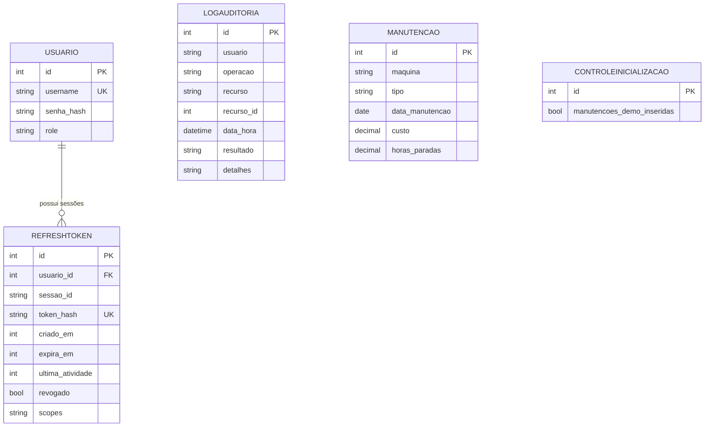

# 🛠️ Sistema de Manutenção de Máquinas

Estudo de caso de **aplicação distribuída em Python** — reprodução do roteiro
*"Estudo de Caso – Sistema Distribuído"* até a **versão 9**, com o modelo
conceitual de vendas substituído por um cenário de **manutenção de máquinas
industriais**.

| | |
|---|---|
| **Backend** | API REST com [FastAPI](https://fastapi.tiangolo.com/) + [SQLModel](https://sqlmodel.tiangolo.com/) + SQLite |
| **Frontend** | Interface web com [Streamlit](https://streamlit.io/) |
| **Segurança** | OAuth2 Password Flow, JWT, scopes, refresh token com rotação, sessões com timeout e auditoria |

## 👥 Integrantes

- **Cristiano Pirolli**
- **Ryan Lirio**

---

## Sumário

1. [Estratégia adotada](#-estratégia-adotada)
2. [Modelo de dados (MER)](#-modelo-de-dados-mer)
3. [Estrutura do projeto](#-estrutura-do-projeto)
4. [Instalação](#-instalação)
5. [Execução](#-execução)
6. [Usando o sistema](#-usando-o-sistema)
7. [Testes automatizados](#-testes-automatizados)
8. [Configuração](#%EF%B8%8F-configuração)
9. [Solução de problemas](#-solução-de-problemas)
10. [Documentação complementar](#-documentação-complementar)

---

## 🎯 Estratégia adotada

Entre as duas alternativas propostas no trabalho, seguimos a **alternativa 2**:

> Mesma linguagem (Python) e mesmas bibliotecas (FastAPI no backend, Streamlit
> no frontend), **modificando o modelo conceitual / MER**.

O CRUD de `vendas` (`id`, `item`, `preco_unitario`, `quantidade`) foi trocado
por um CRUD de **manutenções de máquinas**. Toda a camada de segurança da
versão 9 foi preservada.

Além da troca de domínio, o código monolítico do roteiro (`backend_fastapi.py`
e `frontend_streamlit.py`) foi **reorganizado em pacotes e apps**, seguindo
boas práticas de projetos Python — veja [docs/ARQUITETURA.md](docs/ARQUITETURA.md).
A versão monolítica original continua disponível no primeiro commit do
histórico do Git.

### Equivalência com o roteiro

| Vendas (roteiro original) | Manutenções (este projeto) |
|---|---|
| `GET /vendas` | `GET /manutencoes` |
| `GET /vendas/qtd-vendas` | `GET /manutencoes/qtd` |
| `GET /vendas/faturamento` (preço × qtd) | `GET /manutencoes/resumo` (custo total + horas paradas) |
| `GET /vendas/busca?nome=&min_qtd=` | `GET /manutencoes/busca?maquina=&tipo=&min_horas=` |
| `GET / PUT / DELETE /vendas/{id}`, `POST /vendas` | `GET / PUT / DELETE /manutencoes/{id}`, `POST /manutencoes` |
| scopes `vendas:read/create/update/delete` | scopes `manutencoes:read/create/update/delete` |
| banco `vendas.db` | banco `manutencao.db` |
| `uvicorn backend_fastapi:app` | `uvicorn backend.main:app` |
| `streamlit run frontend_streamlit.py` | `streamlit run frontend/app.py` |

---

## 🗄️ Modelo de dados (MER)

### Tabela principal: `manutencao`

| Campo | Tipo | Regra de negócio |
|---|---|---|
| `id` | INTEGER | Chave primária |
| `maquina` | VARCHAR(100) | Obrigatório; não pode conter apenas espaços |
| `tipo` | VARCHAR | `preventiva`, `corretiva` ou `preditiva` |
| `data_manutencao` | DATE | Não pode estar no futuro |
| `custo` | NUMERIC(10,2) | Maior que zero |
| `horas_paradas` | NUMERIC(6,1) | Zero ou mais |

### Tabelas de suporte (iguais à versão 9 do roteiro)



---

## 📁 Estrutura do projeto

```
manutencao/
├── backend/                      # API FastAPI
│   ├── main.py                   # Ponto de entrada (app, CORS, routers, lifespan)
│   ├── core/                     # Infraestrutura compartilhada
│   │   ├── config.py             # Configurações via variáveis de ambiente
│   │   ├── database.py           # Engine e sessão por requisição (SessionDep)
│   │   ├── security.py           # Hash de senha, JWT, scopes, refresh tokens
│   │   ├── inicializacao.py      # Criação de tabelas, migrações e carga inicial
│   │   ├── schemas.py            # Schemas genéricos
│   │   └── compat.py             # Ajustes de plataforma (Windows)
│   └── apps/                     # Módulos de domínio
│       ├── autenticacao/         # /token, /refresh, /logout + dependência de auth
│       ├── usuarios/             # /usuarios, /me
│       ├── manutencoes/          # CRUD /manutencoes
│       └── auditoria/            # /auditoria
│           # Cada app: models.py · schemas.py · service.py · router.py
│
├── frontend/                     # Interface Streamlit
│   ├── app.py                    # Ponto de entrada (orquestra as telas)
│   ├── core/                     # Infraestrutura do cliente
│   │   ├── config.py             # URL da API e constantes
│   │   ├── api_client.py         # HTTP com renovação automática de token
│   │   ├── estado.py             # Gerenciamento do st.session_state
│   │   ├── formatadores.py       # Moeda, horas e tempo (funções puras)
│   │   └── estilo.py             # CSS global
│   └── apps/                     # Telas por domínio
│       ├── autenticacao/         # Login, cadastro, perfil e barra lateral
│       ├── manutencoes/          # Indicadores, busca, tabela, edição e cadastro
│       └── auditoria/            # Tabela de auditoria
│
├── tests/                        # Testes automatizados (pytest)
│   ├── backend/                  # Testes de API com TestClient
│   └── frontend/                 # Testes das funções puras
├── docs/
│   ├── ARQUITETURA.md            # Decisões de arquitetura e fluxos
│   └── API.md                    # Referência dos endpoints
├── requirements.txt              # Dependências de execução
├── requirements-dev.txt          # Dependências de testes
└── pyproject.toml                # Metadados e configuração do pytest
```

---

## 📦 Instalação

**Pré-requisitos:** Python 3.10 ou superior (testado com 3.14) e Git.

### Opção A — PyCharm (conforme capítulo 2 do roteiro)

1. **Clonar o projeto:** `File ▸ Project from Version Control…` e informar a URL
   deste repositório.
2. **Criar o interpretador:** `File ▸ Settings ▸ Project ▸ Python Interpreter ▸
   Add Interpreter ▸ Add Local Interpreter ▸ Virtualenv Environment ▸ New`,
   com a pasta `.venv` dentro do projeto.
3. **Instalar as dependências** no terminal embutido do PyCharm
   (`View ▸ Tool Windows ▸ Terminal`):

   ```bash
   pip install -r requirements.txt
   ```

### Opção B — Linha de comando

```bash
git clone https://github.com/CristianoPirolli/manutencao-maquinas.git
cd manutencao-maquinas

python -m venv .venv
# Windows
.venv\Scripts\activate
# Linux / macOS
source .venv/bin/activate

pip install -r requirements.txt
```

---

## ▶️ Execução

O sistema é **distribuído em dois processos**. Abra **dois terminais** na raiz do
projeto (no PyCharm, use o botão `+` do terminal embutido para abrir uma
segunda sessão), ambos com o ambiente virtual ativo.

**Terminal 1 — backend (API):**

```bash
uvicorn backend.main:app --reload
```

- API: <http://127.0.0.1:8000>
- Documentação interativa (Swagger): <http://127.0.0.1:8000/docs>

**Terminal 2 — frontend (interface):**

```bash
streamlit run frontend/app.py
```

- Interface: <http://localhost:8501> (abre automaticamente no navegador)

Na primeira execução o backend cria o banco `manutencao.db` na raiz do projeto,
com **5 manutenções de exemplo** e o **usuário administrador**.

---

## 🖥️ Usando o sistema

### Credenciais iniciais

| Perfil | Usuário | Senha |
|---|---|---|
| Administrador | `admin` | `admin123` |

Novos usuários podem ser criados pela própria tela de login (perfil comum).

### Permissões por perfil

| Ação | Scope | Admin | Usuário comum |
|---|---|:---:|:---:|
| Consultar manutenções e indicadores | `manutencoes:read` | ✅ | ✅ |
| Registrar manutenção | `manutencoes:create` | ✅ | ✅ |
| Alterar manutenção | `manutencoes:update` | ✅ | ✅ |
| Excluir manutenção | `manutencoes:delete` | ✅ | ❌ |
| Consultar auditoria | `auditoria:read` | ✅ | ❌ |

### Funcionalidades da interface

- **Barra lateral:** status da API, usuário logado, permissões, contador de
  sessão e indicadores (custo total, horas paradas, total de manutenções).
- **Busca:** filtro por nome da máquina, tipo e horas paradas mínimas.
- **Tabela:** clique em uma linha para carregar o formulário de edição/exclusão.
- **Nova manutenção:** formulário com seleção de tipo e data.
- **Auditoria** (admin): últimas operações registradas no sistema.

### Regras de sessão

| Regra | Valor |
|---|---|
| Validade do access token (JWT) | 15 minutos — renovado automaticamente |
| Validade do refresh token | 7 dias |
| Encerramento por inatividade | 30 minutos |

---

## 🧪 Testes automatizados

```bash
pip install -r requirements-dev.txt
pytest
```

A suíte (64 testes) usa um banco SQLite temporário e cobre:

- login, scopes, refresh com rotação e proteção contra reuso, logout e timeout de sessão;
- cadastro de usuários e restrições do perfil comum;
- CRUD, filtros de busca, indicadores, validações e auditoria de manutenções;
- funções puras do frontend (formatação, validação de formulário e de payloads).

---

## ⚙️ Configuração

Todas as configurações têm valores-padrão para desenvolvimento local e podem
ser sobrescritas por variáveis de ambiente:

| Variável | Onde | Padrão | Descrição |
|---|---|---|---|
| `DATABASE_URL` | backend | `sqlite:///<raiz>/manutencao.db` | URL SQLAlchemy do banco |
| `JWT_SECRET` | backend | chave de desenvolvimento | Chave HS256 (mínimo 32 bytes) |
| `ADMIN_USERNAME` | backend | `admin` | Login do administrador inicial |
| `ADMIN_INITIAL_PASSWORD` | backend | `admin123` | Senha do administrador inicial |
| `CORS_ORIGINS` | backend | `*` | Origens permitidas, separadas por vírgula |
| `API_URL` | frontend | `http://127.0.0.1:8000` | Endereço do backend |

Exemplo — frontend apontando para a API em outra máquina da rede:

```bash
# Windows (PowerShell)
$env:API_URL = "http://192.168.0.10:8000"; streamlit run frontend/app.py
# Linux / macOS
API_URL=http://192.168.0.10:8000 streamlit run frontend/app.py
```

> ⚠️ Em qualquer ambiente que não seja de estudo, defina `JWT_SECRET` e
> `ADMIN_INITIAL_PASSWORD` próprios.

---

## 🩺 Solução de problemas

| Sintoma | Causa provável | Solução |
|---|---|---|
| `ModuleNotFoundError: No module named 'backend'` | Comando executado fora da raiz | Rode o `uvicorn` a partir da pasta do projeto |
| Frontend mostra **🔴 API indisponível** | Backend parado ou em outra porta | Inicie o backend ou ajuste `API_URL` |
| `ImportError: DLL load failed ... política de Controle de Aplicativo` | *Smart App Control* do Windows bloqueando extensões compiladas do SQLAlchemy | Reinstale sem extensões C: `set DISABLE_SQLALCHEMY_CEXT=1` e `pip install --force-reinstall --no-binary sqlalchemy sqlalchemy` |
| `RuntimeError: Já existe 'admin' com perfil comum` | Usuário comum criado com o login do admin | Use outro `ADMIN_USERNAME` ou apague `manutencao.db` |
| Quero recomeçar com os dados de exemplo | — | Pare o backend e apague `manutencao.db` |

---

## 📚 Documentação complementar

- [docs/ARQUITETURA.md](docs/ARQUITETURA.md) — organização em camadas, fluxos de
  autenticação e decisões de projeto.
- [docs/API.md](docs/API.md) — referência completa dos endpoints.
- Swagger da API em execução: <http://127.0.0.1:8000/docs>
