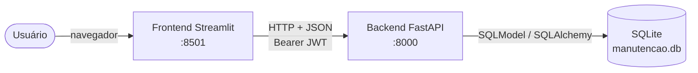
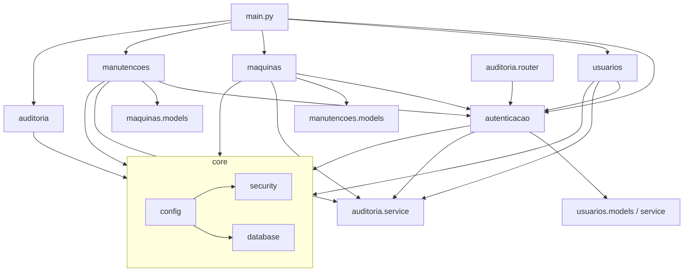
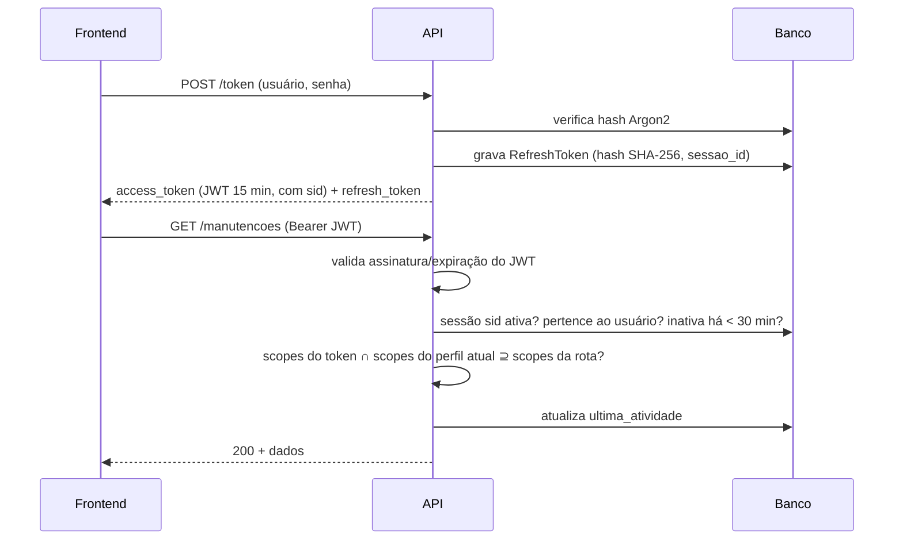
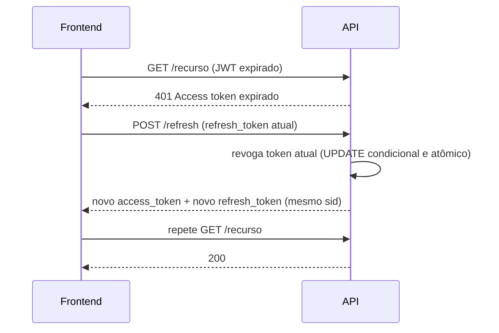

# Arquitetura

Este documento descreve como o projeto está organizado e por quê.

## Visão geral

O sistema tem dois processos independentes que se comunicam apenas por HTTP/JSON —
por isso podem rodar em máquinas diferentes (sistema distribuído):

O frontend **não acessa o banco**: toda regra de negócio e de segurança vive no
backend. As validações feitas no frontend servem apenas para dar retorno
rápido ao usuário e são sempre repetidas pela API.

## Do monólito aos apps

O roteiro entrega cada lado em um único arquivo (`backend_fastapi.py` com ~1.300
linhas e `frontend_streamlit.py` com ~1.000). O projeto foi reorganizado em
**pacotes por responsabilidade**, de forma semelhante aos *apps* do Django:

| Camada | Responsabilidade | Pode importar de |
|---|---|---|
| `core/` | Infraestrutura transversal (config, banco, segurança) | bibliotecas externas |
| `apps/<dominio>/` | Um domínio de negócio completo | `core/` e outros apps |
| `main.py` / `app.py` | Montagem da aplicação | tudo |

### Convenção de arquivos dos apps do backend

| Arquivo | Conteúdo |
|---|---|
| `models.py` | Tabelas (`SQLModel, table=True`) |
| `schemas.py` | Contratos de entrada e saída da API |
| `service.py` | Regras de negócio, sem conhecimento de rotas |
| `router.py` | Endpoints (`APIRouter`) — finos, delegam ao `service` |
| `dependencies.py` | Dependências FastAPI (apenas em `autenticacao`) |

Separar `router` de `service` permite testar e reutilizar regras sem passar pelo
HTTP e mantém cada endpoint com poucas linhas.

### Dependências entre apps do backend

Não há ciclos: `auditoria.service` e os arquivos `models.py` são "folhas" usadas
pelos demais apps. `maquinas` e `manutencoes` dependem apenas dos *models* um do
outro (para o JOIN e para a contagem), nunca dos services ou routers.

### Migração do campo `maquina` (texto) para a tabela `maquina`

Bancos criados antes do cadastro de máquinas guardavam o nome da máquina como
texto em cada manutenção. Na subida, `core/inicializacao.py` detecta esse
formato e, em uma transação: faz uma cópia do arquivo (`manutencao.pre-maquinas.db`),
cria uma máquina para cada nome distinto, reconstrói a tabela `manutencao` com
`maquina_id` e confere se a quantidade de registros se manteve.

### Frontend

O Streamlit re-executa `frontend/app.py` inteiro a cada interação. Esse arquivo
apenas define **a ordem das telas**; cada tela é uma função `renderizar_*` em
`frontend/apps/<dominio>/views.py`.

| Módulo | Papel |
|---|---|
| `core/api_client.py` | Única porta de saída para a API; renova o token em caso de 401 |
| `core/estado.py` | Única porta de acesso ao `st.session_state` |
| `core/formatadores.py` | Funções puras (testáveis sem Streamlit) |
| `core/crud.py` | Barra Nova / Editar / Excluir e tabela com seleção, usadas por Registros e Máquinas |
| `apps/*/views.py` | Desenho das telas |
| `apps/manutencoes/formulario.py` | Validação e serialização do formulário (pura) |
| `apps/manutencoes/analise.py` | DataFrame, frase de destaque e proporção por tipo (pura) |
| `apps/manutencoes/graficos.py` | Gráficos Altair com a paleta dos tipos de manutenção |
| `.streamlit/config.toml` | Tema: cores, fontes Barlow e barra lateral |

As telas de cadastro seguem um padrão único: a barra de ações é um
`st.container` criado antes da tabela e preenchido depois dela, quando a linha
selecionada já é conhecida. A `key` da tabela inclui os ids exibidos, então
filtrar ou salvar descarta a seleção antiga em vez de apontá-la para outro
registro.

Cadastro, edição e exclusão acontecem em janelas modais (`st.dialog`). Como a janela é
um fragmento, interagir com ela re-executa só a janela; ao concluir, um
`st.rerun()` completo fecha a janela, renova a tabela e exibe um aviso (toast).

## Fluxos de segurança

### Login e uso de rota protegida

### Renovação automática (refresh com rotação)

Se o mesmo refresh token for usado duas vezes (vazamento ou requisições
concorrentes), a segunda tentativa é tratada como **reuso**: a sessão inteira
é revogada, invalidando também o token emitido na rotação (detecção de reuso,
RFC 6819 / OAuth 2.0 Security BCP). O usuário legítimo precisa entrar de novo.

### Encerramento de sessão

| Evento | Efeito |
|---|---|
| `POST /logout` | Revoga todos os refresh tokens da sessão; o JWT ainda válido passa a ser recusado porque o `sid` não está mais ativo |
| 30 min sem atividade | Próxima chamada revoga a sessão e retorna 401 |
| Refresh token com mais de 7 dias | Sessão revogada |
| Perfil do usuário rebaixado | Scopes efetivos são recalculados a cada requisição |

## Decisões de projeto

| Decisão | Motivo |
|---|---|
| `lifespan` em vez de inicializar o banco no import | O app pode ser importado sem efeitos colaterais; o banco só é criado quando o servidor sobe |
| Sessão de banco por requisição (`SessionDep`) | Ciclo de vida explícito e fechamento garantido |
| Auditoria na mesma transação da operação | O log só existe se a operação foi efetivada |
| Somas de custo em `Decimal` no Python | O SQLite converte `NUMERIC` em ponto flutuante |
| Listagens retornam `{id: manutencao}` | Mantém o contrato usado pelo roteiro original |
| Migrações leves com `ALTER TABLE` | Simplicidade didática; em produção usar Alembic |
| Refresh token opaco, com apenas o hash no banco | Vazamento do banco não expõe tokens válidos |
| Configurações por variáveis de ambiente | Mesmo código em qualquer ambiente, sem segredos no repositório |
